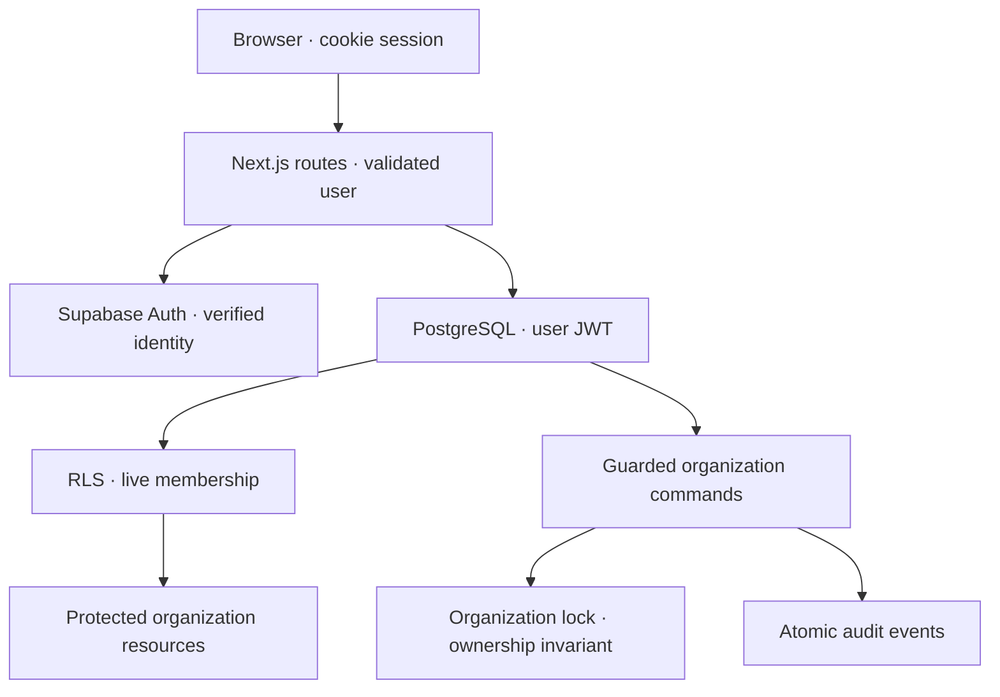
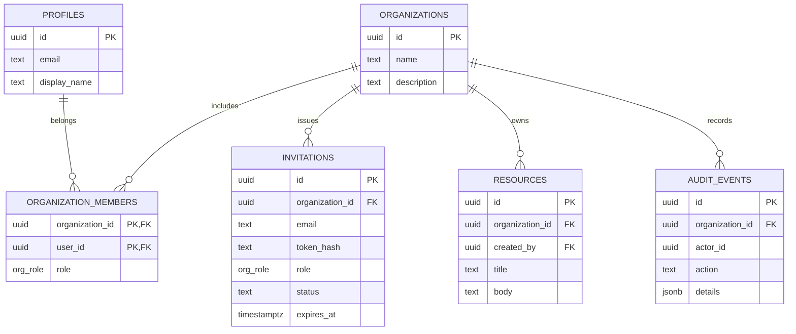

# Architecture

The application has two independent enforcement layers: the Next.js API validates identity, input and organization membership; PostgreSQL validates live sessions, current membership, row visibility and mutation privileges.

No runtime operation requires the service-role key. Direct Data API calls encounter the same RLS and grants as server requests. The organization switcher stores only a UI preference; it supplies no authority.

## Entity relationships

Profiles reference Supabase Auth users. Membership references profiles with delete restriction, preventing identity deletion from silently orphaning ownership. Offboard memberships before removing an Auth identity. Audit actor IDs are historical identifiers and may refer to an account that has since left.

## Transaction boundaries

Creating an organization inserts the organization, first Owner and audit event atomically. All later membership writers lock the organization row, then read the acting user's current role, apply the permitted change, and append the audit event. Invitation acceptance follows the same lock order before locking and consuming the invitation. Concurrent Owner changes therefore cannot both remove the final Owner.

Protected resource writes use column grants and RLS. A database trigger appends their audit event within the same transaction. Resource organization and creator IDs are immutable to application roles.

## Session semantics

A valid, signed JWT must identify a verified user and an existing session. RLS checks `auth.sessions` using the token's `session_id`, provider expiration, and a seven-day maximum application age. Removing membership stops subsequent tenant access immediately. Revoking a session stops subsequent database access immediately, even before its JWT expires.

This guarantee covers protected application data. Supabase Auth itself controls password recovery, token refresh and Auth endpoint behavior. Browser state may remain visible until refresh, but subsequent protected requests fail.

## Privilege boundary

Narrow private SECURITY DEFINER functions are necessary for session lookup and transactional organization bootstrap/administration. They use an empty search path, explicit schema names, active-user checks and revoked default EXECUTE privileges. Public RPC wrappers are SECURITY INVOKER. The private schema is not exposed to PostgREST.

The database owner and service role are trusted operators. They can bypass RLS; keys are excluded from runtime and restricted to deliberate fixture setup.

## Trade-offs

Shared tables plus RLS keep infrastructure simple. A separate database per tenant would increase operational cost. Four fixed roles make behavior reviewable; a custom policy language would enlarge the security surface. SMTP delivery is outside the organization transaction: an invitation can exist while delivery fails, and the interface makes that state explicit. Auth audit logs stay with the identity provider, avoiding a misleading client-written security log.
